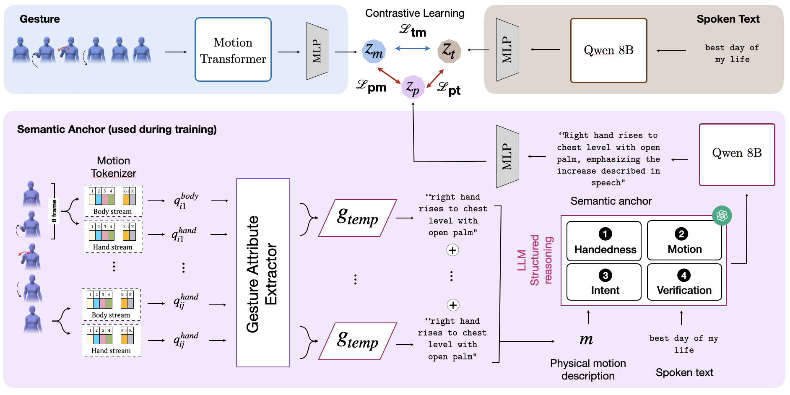

<div align="center">

<h1>Semantic Motion Anchors: Bridging Motion and Meaning in Co-Speech Gestures</h1>

**NeurIPS 2026**

Varsha Suresh, Mohammad Mahdi Abootorabi, Mohamed Salman, M. Hamza Mughal, Christian Theobalt, Ashwin Ram, Jürgen Steimle, Vera Demberg

[](https://arxiv.org/abs/2605.30608)
[](https://huggingface.co/datasets/aboots/SEMANTIX)
[](https://neurips.cc/virtual/2026/loc/paris/poster/154665)

</div>

Semantic motion anchors are natural-language descriptions of a gesture's physical form and communicative intent. Gestures are tokenized into body and hand motion primitives, verbalized into physical descriptions, and grounded in the transcript with an LLM. The resulting anchors supervise a contrastive text-gesture retrieval model during training. At test time retrieval uses only the transcript and motion branches.



This repository contains the retrieval model, the BEAT2 and cross-dataset (TED/BEAT2) evaluations, and the prompts used to build and split the anchors. The human-annotated evaluation set and the generated anchors are on the Hugging Face Hub as [SEMANTIX](https://huggingface.co/datasets/aboots/SEMANTIX).

## Contents

```
semantic_motion_anchors/   retrieval model, preprocessing, training and evaluation
configs/                   experiment configs (base.yaml holds the shared settings)
  controls/                random, mismatched, physical-only and intent-only anchors
  baselines/               TMR-, JEGAL- and GestureDiffuCLIP-style objectives
anchors/                   anchor-generation and LLM-judge prompts, anchor splitting (App. A.3, A.7)
scripts/                   data preparation, experiment runners, tables and figures
```

## Setup

Tested with Python 3.14, PyTorch 2.11 and sentence-transformers 5.2.

```bash
pip install -r requirements.txt
pip install -e .
```

## Data

**BEAT2.** Download the English v2.0.0 SMPL-X motion, semantic labels and TextGrids from [BEAT2](https://huggingface.co/datasets/H-Liu1997/BEAT2), then cut every gesture into a clip with ±5 s of context and its transcript window:

```bash
hf download H-Liu1997/BEAT2 --repo-type dataset --local-dir data/beat2 \
    --include "beat_english_v2.0.0/smplxflame_30/*" "beat_english_v2.0.0/sem/*" "beat_english_v2.0.0/textgrid/*"
python scripts/prepare_beat2.py --beat2-dir data/beat2/beat_english_v2.0.0 --output-dir data/beat2/clips_w5s
```

**Semantic motion anchors.** The generated anchors for the 17,106 BEAT2 semantic gestures, and the TED inputs of the cross-dataset evaluation, are the `addons/` folder of SEMANTIX:

```bash
hf download aboots/SEMANTIX --repo-type dataset --include "addons/*" --local-dir data/semantix
```

| File | Contents |
|---|---|
| `addons/beat2_anchors.csv` | One row per BEAT2 gesture: clip id, train/val/test split, transcript, semantic motion anchor `a`, its physical-form part `a_phys`, its intent part `a_int` and intent category |
| `addons/beat2_motion_narratives.jsonl` | Verbalized motion narrative `m` of each gesture: body and hand description of every 8-frame motion token, the input of the anchor-generation prompt |
| `addons/ted_eval.csv` | The 778 SEMANTIX TED gestures with the transcript query and the gesture-lexicon description used to represent TED gestures in Tables 5, 6 and 12 |

**TED motion (optional).** The motion-embedding rows of the TED evaluations need SMPL-X poses of the 778 TED gestures at 15 fps, estimated from the talk videos with a monocular estimator (for instance ExPose or SMPLest-X), which we do not redistribute. Provide them as `data/ted/ted_smplx.npz` with arrays `sample_id` and `data_poses` (one `(T, 165)` array per gesture). All other evaluations run without it.

The data paths are set in [configs/base.yaml](configs/base.yaml).

## Training and evaluation

All experiments ran on a single H100 GPU. Embed transcripts and anchors with the frozen text encoder (Qwen3-Embedding-8B; CLIP ViT-B/32 for the GestureDiffuCLIP-style baseline). This builds the clip manifest and the 90/5/5 split (15,395 / 855 / 856 clips) once:

```bash
python -m semantic_motion_anchors.preprocess --config configs/semantic_anchors.yaml
python -m semantic_motion_anchors.preprocess --config configs/baselines/gesturediffuclip.yaml
```

Training has two stages. The transcript-motion model (Text Contrastive) is trained first. The anchor-supervised model is then initialized from it with a fresh anchor projector and fine-tuned with the full objective (Eq. 2: λs = 0.15, λp = 0.03, λb = 0.02). Model selection uses transcript-motion MRR on the validation split.

```bash
python -m semantic_motion_anchors.train --config configs/text_contrastive.yaml --seed 42
python -m semantic_motion_anchors.train --config configs/semantic_anchors.yaml --seed 42
python -m semantic_motion_anchors.evaluate --config configs/semantic_anchors.yaml --seed 42
```

Runs are written to `outputs/runs/<config name>_seed<seed>/`; `--set key.path=value` overrides any config entry.

## Semantic motion anchors

Anchors are generated from the verbalized motion narrative `m` and the transcript with the structured-reasoning prompt in [anchors/prompts/semantic_anchor_generation.txt](anchors/prompts/semantic_anchor_generation.txt) (GPT-5.4). Generated anchors are compared with SEMANTIX gold descriptions using [anchors/prompts/llm_judge.txt](anchors/prompts/llm_judge.txt). Both prompts are reproduced from Appendix A.3. Each anchor is split into its physical-form and intent parts with Qwen3-8B (Appendix A.7):

```bash
python anchors/split_anchors.py --input anchors.csv --output anchors_split.csv
```

The motion tokenizer (two-stream RVQ-VAE) and the rule-based attribute verbalizer (Appendix A.1–A.2) will be added to this repository. All retrieval experiments can be reproduced from the released anchors.

## Citation

```bibtex
@misc{suresh2026semanticmotionanchorsbridging,
      title={Semantic Motion Anchors: Bridging Motion and Meaning in Co-Speech Gestures},
      author={Varsha Suresh and Mohammad Mahdi Abootorabi and Mohamed Salman and M. Hamza Mughal and Christian Theobalt and Ashwin Ram and Jürgen Steimle and Vera Demberg},
      year={2026},
      eprint={2605.30608},
      archivePrefix={arXiv},
      primaryClass={cs.CL},
      url={https://arxiv.org/abs/2605.30608},
}
```

If you use BEAT2, please also cite [EMAGE (Liu et al., CVPR 2024)](https://github.com/PantoMatrix/PantoMatrix).

## License

The code is released under the [MIT License](LICENSE). SEMANTIX annotations and anchors are released under CC BY-NC 4.0; BEAT2 and the TED talks keep their original licenses.
